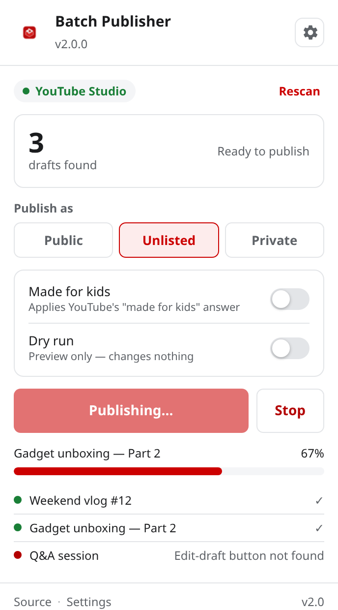
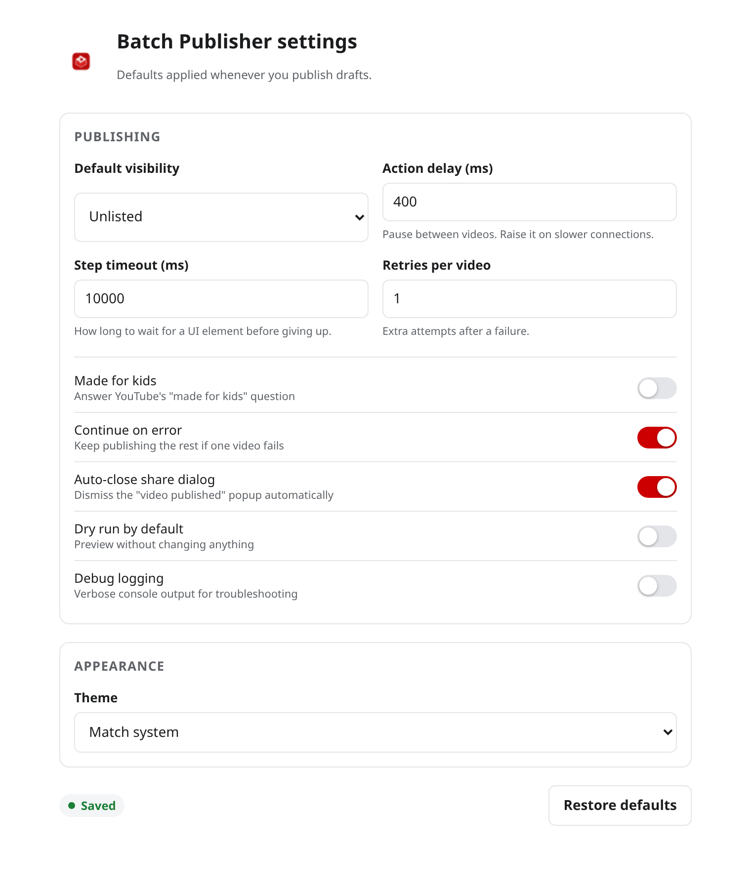

<div align="center">


# 🚀 YouTube Video Batch Publisher

**Publish every YouTube Studio draft in one click.**
Pick a visibility, press one button, and watch them all go out — with a live
progress bar and a Stop button you can actually use.

[](https://github.com/pavnxet/YT-Video-Batch-Publisher/actions/workflows/ci.yml)
[](https://github.com/pavnxet/YT-Video-Batch-Publisher/releases/latest)
[](LICENSE)
[](CHANGELOG.md)
[](#-install)
[](#-install)
[](#-development)
[](#-contributing)

[**Install**](#-install) · [**Usage**](#-usage) · [**Settings**](#%EF%B8%8F-settings) · [**Documentation**](https://pavnxet.github.io/YT-Video-Batch-Publisher/) · [**FAQ**](#-faq)

</div>

---

## 😩 The problem

You've finished a batch of videos. They're sitting in YouTube Studio as
**drafts**, waiting for you to open each one, click through the visibility step,
answer the "made for kids" question, hit save, and dismiss the confirmation
popup. Again. And again. And again.

Twenty uploads means twenty rounds of the same four clicks.

## ✨ The solution

This extension does that loop for you.

| | |
|---|---|
| ⚡ **Batch publish** | Publishes every draft visible on your Studio content page in one run. |
| 🎛️ **You pick the visibility** | Public, Unlisted or Private — chosen by the option's label, so the right one always gets picked. |
| 👶 **Made for kids, answered** | Sets the "made for kids" answer automatically to whatever you configured. |
| 📊 **Live progress** | A progress bar and a per-video log, so you always know exactly where it is. |
| 🛑 **Stop any time** | A real Stop button that halts the run cleanly between videos. |
| 🧪 **Dry run** | Scans your drafts and reports what it *would* do, without touching a thing. |
| 🔁 **Retries that work** | A failed video is retried, reported, and skipped — the rest of the batch keeps going. |
| 🌗 **Light & dark** | Follows your system theme, or pin it to either. |
| 📦 **Zero dependencies** | The extension ships as plain JavaScript. Nothing to audit, nothing to break. |
| 🔒 **Stays on your machine** | No accounts, no servers, no analytics. It talks to YouTube Studio and nothing else. |

<div align="center">



</div>

---

## 📥 Install

> [!WARNING]
> **Do not load the repository root into your browser.** The source tree has no
> `manifest.json` at the top level — the loadable extension is generated into
> `dist/`. Download a release below, or build it yourself.

### Option A — grab a ready-made build (no tools needed)

| Browser | Download |
|---|---|
| **Chrome · Edge · Brave · Opera** | [**yt-video-batch-publisher-2.0.0-chrome.zip**](https://github.com/pavnxet/YT-Video-Batch-Publisher/releases/latest) |
| **Firefox 115+** | [**yt-video-batch-publisher-2.0.0-firefox.zip**](https://github.com/pavnxet/YT-Video-Batch-Publisher/releases/latest) |

**Chrome / Edge / Brave / Opera**

1. **Download the Chrome zip** and **extract it** to a folder you will keep
   (e.g. `C:\Extensions\yt-batch-publisher`). Chrome cannot load an extension
   from inside a `.zip`.
2. Open `chrome://extensions/` (or `edge://extensions`, `brave://extensions`).
3. Switch on **Developer mode** — the toggle in the top-right corner.
4. Click **Load unpacked** and select the folder you extracted — the one
   containing `manifest.json`.
5. Pin the extension to your toolbar.

**Firefox**

1. **Download the Firefox zip** and extract it.
2. Open `about:debugging#/runtime/this-firefox`.
3. Click **Load Temporary Add-on…** and select the extracted `manifest.json`.

For a permanent Firefox install, sign the extracted folder:

```bash
npx web-ext build -s <extracted-folder>
```

### Option B — build from source

Needs [Node.js 20+](https://nodejs.org/).

```bash
git clone https://github.com/pavnxet/YT-Video-Batch-Publisher.git
cd YT-Video-Batch-Publisher
npm install
npm run build
```

That produces `dist/chrome` and `dist/firefox`. Load **`dist/chrome`** as
described above (not the repository root).

📖 Step-by-step, with screenshots: **[Installation guide](https://pavnxet.github.io/YT-Video-Batch-Publisher/install.html)**

---

## 🎬 Usage

1. Open **[YouTube Studio → Content](https://studio.youtube.com/)**.
2. Click the extension icon. The popup tells you how many drafts it can see.
3. Choose a visibility, and optionally flip **Made for kids** or **Dry run**.
4. Press **Publish drafts**.
5. Watch the progress bar. Hit **Stop** whenever you like.

> 💡 **Tip:** Filter the content page to **Drafts** first. The extension publishes
> exactly the rows that are visible, so filtering is the fastest way to control
> what gets published.

> ⚠️ **Keep the tab open** while a run is in progress — the work happens in the page.

---

## ⚙️ Settings

Open them from the ⚙️ gear in the popup, or via **Settings**. Everything is
stored in `chrome.storage.sync`, so your preferences follow you across devices.

| Setting | Default | What it does |
|---|---|---|
| 🎯 **Default visibility** | Unlisted | The visibility pre-selected in the popup |
| 👶 **Made for kids** | Off | The answer given to YouTube's "made for kids" question |
| ⏱️ **Action delay** | 400 ms | Pause between videos — raise it on a slow connection |
| ⏳ **Step timeout** | 10 000 ms | How long to wait for a UI element before giving up |
| 🔁 **Retries per video** | 1 | Extra attempts after a failure |
| ➡️ **Continue on error** | On | Keep publishing the rest when one video fails |
| 🪟 **Auto-close share dialog** | On | Dismiss the "video published" popup automatically |
| 🧪 **Dry run** | Off | Preview only — changes nothing |
| 🐞 **Debug logging** | Off | Verbose console output for troubleshooting |
| 🌗 **Theme** | Match system | Light, dark, or follow the system |

<div align="center">



</div>

---

## 🧠 How it works

```
   ┌──────────┐   message    ┌──────────────┐   inject    ┌──────────────────┐
   │  Popup   │ ───────────▶ │  Background  │ ──────────▶ │  Content script  │
   │   (UI)   │ ◀─────────── │   (worker)   │             │  studio.youtube  │
   └──────────┘   progress   └──────────────┘             └──────────────────┘
                                                                │
                                                                ▼
                                                    ┌───────────────────────┐
                                                    │   PublishEngine       │
                                                    │  scan → open → set →  │
                                                    │  save → dismiss       │
                                                    └───────────────────────┘
```

1. The popup asks the background worker for the active tab, and checks it really
   is `studio.youtube.com`.
2. The worker makes sure the content script is alive — injecting it on demand if
   the tab was already open when the extension was installed — and forwards the
   request.
3. The content script runs the publish engine: it finds every video row with an
   edit-draft button, then for each one opens the draft, sets the "made for kids"
   answer, walks to the visibility step, selects the option **whose label matches**
   your choice, saves, and dismisses the share dialog.
4. Every step is timeout-bounded and cancellable. Failures are retried and
   reported instead of being swallowed.
5. Progress streams back to the popup as it happens.

📚 **Full documentation → [pavnxet.github.io/YT-Video-Batch-Publisher](https://pavnxet.github.io/YT-Video-Batch-Publisher/)**

---

## 🛠️ Development

```bash
npm install        # dev-only dependencies (jsdom, for the tests)
npm run build      # src/ → dist/chrome and dist/firefox
npm run validate   # check manifests, file references and bundle syntax
npm test           # run the test suite
npm run ci         # all of the above, in order
```

### 📁 Project structure

```
src/
  common/platform.js    chrome.* / browser.* shim + promise wrapper
  core/
    dom.js              sleep / waitForElement / click — all AbortSignal-aware
    selectors.js        every YouTube selector, each with fallbacks
    settings.js         defaults, validation, storage persistence
    messaging.js        the popup ⇄ background ⇄ content message contract
    publisher.js        the batch-publish engine
    sorter.js           the playlist-sorting engine
  content/content.js    content-script entry point
  background/           MV3 service worker / event page
  popup/                toolbar popup
  options/              settings page
  ui/                   shared design tokens
manifests/              chrome.json, firefox.json
build/                  build.mjs · validate.mjs · preview.mjs
tests/                  node:test + jsdom
docs/                   the documentation site
```

Source files are plain scripts that share a single `globalThis.YTBP` namespace,
so the "bundler" is an ordered concatenation — there is no build dependency to
audit. The tests load the same files, **and the built bundles**, into jsdom, so
they exercise the code that actually ships.

---

## ❓ FAQ

<details>
<summary><strong>How many videos can it publish at once?</strong></summary>

As many drafts as are visible on the page. Filter or scroll first to control the
set — the extension only touches rows currently in the DOM.
</details>

<details>
<summary><strong>Will it work if YouTube changes their interface?</strong></summary>

Every selector lives in one file (`src/core/selectors.js`) with ordered
fallbacks, and options are matched by their visible label rather than by
position. A redesign may still need a selector added there — that's a
one-file change.
</details>

<details>
<summary><strong>Can I undo a publish?</strong></summary>

Yes — change the visibility back in YouTube Studio, or delete the video. Use
**Dry run** first if you're unsure what a run would do.
</details>

<details>
<summary><strong>Does it collect any data?</strong></summary>

No. There is no server, no analytics, and no account. The only network traffic
is the page talking to YouTube Studio, exactly as it would without the extension.
</details>

<details>
<summary><strong>Why do I need to build it myself?</strong></summary>

The build step turns one `src/` tree into both a Chrome and a Firefox package.
It takes a few seconds and keeps the two from drifting apart. Pre-built folders
land in `dist/`.
</details>

<details>
<summary><strong>The popup says "Not on Studio" — why?</strong></summary>

It only activates on `studio.youtube.com`. Open your Studio content page and
click the icon again.
</details>

---

## 🤝 Contributing

Bug reports and pull requests are very welcome — please read
[CONTRIBUTING.md](CONTRIBUTING.md) first, and check the
[open issues](https://github.com/pavnxet/YT-Video-Batch-Publisher/issues).

- 🐞 Found a bug? [Open an issue](https://github.com/pavnxet/YT-Video-Batch-Publisher/issues/new/choose)
- 💡 Got an idea? [Request a feature](https://github.com/pavnxet/YT-Video-Batch-Publisher/issues/new/choose)
- ⭐ Enjoying it? A star helps other creators find it.

---

## 📄 License

[MIT](LICENSE) © pavnxet

## ⚠️ Disclaimer

This extension automates actions inside **your own** YouTube Studio account.
You are responsible for what gets published. Use **Dry run** when you're trying
something new.

<div align="center">
<sub>Built for creators who'd rather make videos than click buttons.</sub>
</div>
